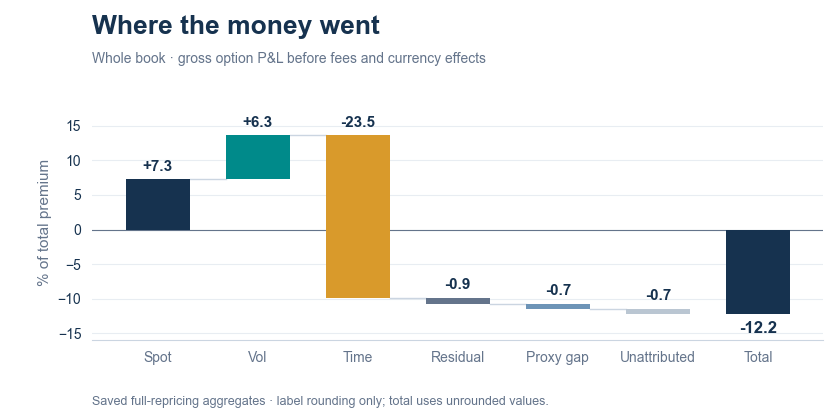
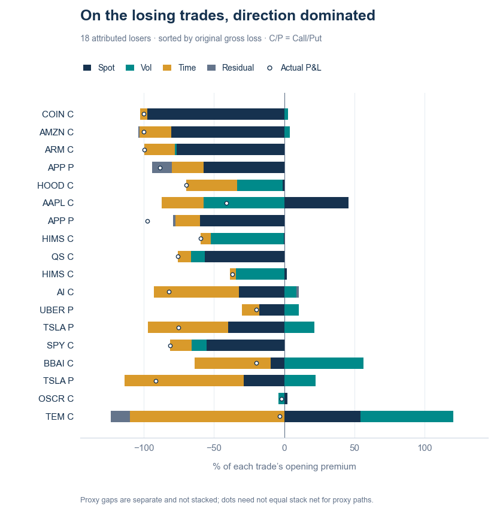

# Options P&L Attribution on Real Trades

Thirty-eight option trades, July–August 2025, repriced step by step (spot → vol → time) to see where the money went. Across the whole book, time decay was the only net drag: −23.5% of premium, against +7.3% from spot and +6.3% from vol. On the losing trades themselves the story is different: 60% of losses came from direction, 25% from time, 9% from vol — and five trades account for 76% of all losses.

Each trade is fully repriced with Black-Scholes along the path spot → vol → time, on actual fills and daily closes; 30 of 38 trades are attributed, covering 94% of premium. Implied vols are backed out from fills and end-of-day option quotes. The residual is what repricing does not explain — 7% of net P&L — reported separately from the proxy and unattributed items rather than folded into any factor.

- The fixed spot → vol → time order allocates cross-effects according to the repricing sequence, generally to the later step; it is one convention, not the only one.
- Earnings crossings (12 trades), 0DTE and deep-OTM legs push some quotes to identification limits; where an IV cannot be identified it is frozen, so a zero vol contribution there means "not identified", not "unchanged".
- Seven trades had no separable market states; one index-option trade was outside model scope. All eight are reported but not attributed.

Data: trade records provided by the author, anonymised; all figures as a percentage of premium. [Method and conventions](method/attribution.md).
